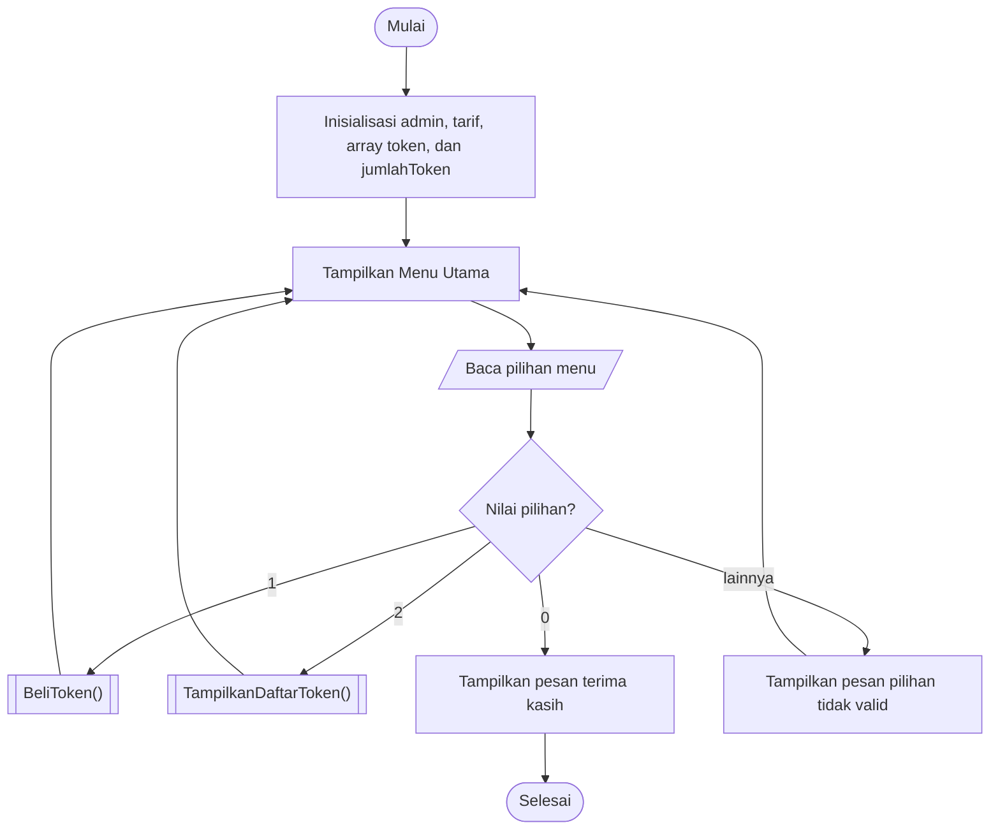
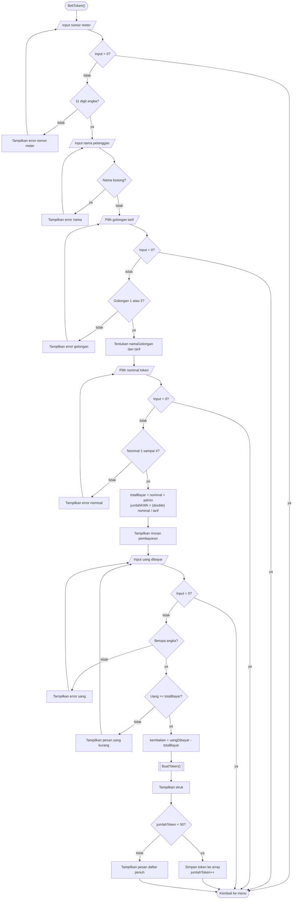
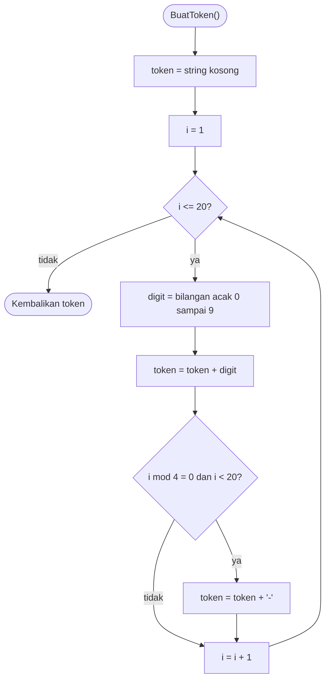

# TokenKu

Aplikasi konsol simulasi penjualan token listrik PLN untuk Tugas Besar Dasar-Dasar Pemrograman (DDP) 2026, kelompok The Last Star. Seluruh logika berada di dalam satu method `main` tanpa OOP. Input dibaca dengan `Scanner` dan token disimpan di dalam array.

## Fitur

- Beli token dengan validasi nomor meter, nama pelanggan, golongan tarif, nominal, dan uang dibayar.
- Perhitungan total bayar, jumlah kWh, dan kembalian.
- Pembuatan nomor token acak 20 digit dengan format `xxxx-xxxx-xxxx-xxxx-xxxx`.
- Penyimpanan maksimal 50 token selama program berjalan.
- Menampilkan daftar token yang sudah tersimpan.

## Konfigurasi

| Komponen | Nilai |
|---|---|
| Biaya admin | 2500 |
| Tarif 900 VA Subsidi | 605 per kWh |
| Tarif 900 VA RTM | 1352 per kWh |
| Kapasitas daftar token | 50 |

Kata kunci `0` dipakai untuk membatalkan proses Beli Token dan kembali ke menu utama. Pengecualian ada pada input nama pelanggan karena semua teks, termasuk `0`, dianggap sebagai nama.

## Pseudocode

### Program utama

```text
MULAI
    admin ← 2500
    tarifSubsidi ← 605
    tarifRtm ← 1352
    maksToken ← 50
    daftarToken ← array string berukuran maksToken
    jumlahToken ← 0
    kembali ← "0"
    jalan ← true

    SELAMA jalan = true LAKUKAN
        tampilkan Menu Utama
        baris ← baca satu baris input
        pilihan ← integer pertama pada baris, atau -1 jika tidak ada

        PILIH pilihan
            KASUS 1
                BeliToken()
            KASUS 2
                TampilkanDaftarToken()
            KASUS 0
                jalan ← false
                tampilkan "Terima kasih telah menggunakan TokenKu!"
            LAINNYA
                tampilkan "Pilihan tidak valid. Silakan coba lagi."
        SELESAI
    SELESAI
SELESAI
```

### Beli token

```text
PROSEDUR BeliToken
    tampilkan header "BELI TOKEN"

    ULANGI
        noMeter ← baca input, trim
        JIKA noMeter = kembali MAKA
            tampilkan "Kembali ke menu utama."
            KEMBALI
        SELESAI
        JIKA panjang(noMeter) ≠ 11 ATAU ada karakter bukan digit MAKA
            tampilkan error nomor meter
    SAMPAI noMeter valid

    ULANGI
        nama ← baca input, trim
        JIKA nama kosong MAKA
            tampilkan "Nama tidak boleh kosong. Silakan ulang."
    SAMPAI nama tidak kosong

    golongan ← 0
    SELAMA golongan ≠ 1 DAN golongan ≠ 2 LAKUKAN
        tampilkan pilihan golongan tarif
        baris ← baca input, trim
        JIKA baris = kembali MAKA
            tampilkan "Kembali ke menu utama."
            KEMBALI
        SELESAI
        golongan ← integer pertama pada baris, atau 0
        JIKA golongan ≠ 1 DAN golongan ≠ 2 MAKA
            tampilkan "Golongan tidak valid. Silakan ulang."
    SELESAI

    JIKA golongan = 1 MAKA
        namaGolongan ← "900 VA Subsidi"
        tarif ← tarifSubsidi
    LAINNYA
        namaGolongan ← "900 VA RTM"
        tarif ← tarifRtm
    SELESAI

    nominal ← 0
    SELAMA nominal = 0 LAKUKAN
        tampilkan pilihan nominal token
        baris ← baca input, trim
        JIKA baris = kembali MAKA
            tampilkan "Kembali ke menu utama."
            KEMBALI
        SELESAI
        pilihanNominal ← integer pertama pada baris, atau 0
        PILIH pilihanNominal
            KASUS 1: nominal ← 20000
            KASUS 2: nominal ← 50000
            KASUS 3: nominal ← 100000
            KASUS 4: nominal ← 200000
            LAINNYA: tampilkan "Nominal tidak valid. Silakan ulang."
        SELESAI
    SELESAI

    totalBayar ← nominal + admin
    jumlahKWh ← (double) nominal / tarif
    kWhTeks ← format jumlahKWh dengan 2 desimal, ganti titik menjadi koma
    tampilkan rincian pembayaran

    uangDibayar ← 0
    SELAMA uangDibayar < totalBayar LAKUKAN
        tampilkan permintaan uang dibayar
        baris ← baca input, trim
        JIKA baris = kembali MAKA
            tampilkan "Kembali ke menu utama."
            KEMBALI
        SELESAI
        JIKA baris bukan integer MAKA
            tampilkan "Uang harus berupa angka. Silakan ulang."
            LANJUT
        SELESAI
        uangDibayar ← integer pertama pada baris
        JIKA uangDibayar < totalBayar MAKA
            tampilkan pesan uang kurang
    SELESAI

    kembalian ← uangDibayar - totalBayar
    token ← BuatToken()
    tampilkan struk berisi data pelanggan, rincian biaya, kWh, dan token

    JIKA jumlahToken < maksToken MAKA
        daftarToken[jumlahToken] ← token
        jumlahToken ← jumlahToken + 1
    LAINNYA
        tampilkan "Daftar token penuh, token tidak disimpan."
    SELESAI
SELESAI
```

### Pembuatan token

```text
FUNGSI BuatToken
    token ← ""
    UNTUK i ← 1 SAMPAI 20 LAKUKAN
        digit ← bilangan bulat acak 0 sampai 9
        token ← token + digit
        JIKA i mod 4 = 0 DAN i < 20 MAKA
            token ← token + "-"
        SELESAI
    SELESAI
    KEMBALIKAN token
SELESAI
```

### Daftar token

```text
PROSEDUR TampilkanDaftarToken
    tampilkan header "DAFTAR TOKEN"
    JIKA jumlahToken = 0 MAKA
        tampilkan "Belum ada token."
    LAINNYA
        UNTUK i ← 0 SAMPAI jumlahToken - 1 LAKUKAN
            tampilkan nomor urut (i + 1) dan daftarToken[i]
        SELESAI
    SELESAI
SELESAI
```

## Flowchart

### Alur program utama



### Alur beli token



### Alur pembuatan token



## Catatan

- Token hanya tersimpan di memori. Data hilang saat program ditutup.
- Nomor token dibuat acak tanpa pengecekan duplikat.
- Perhitungan kWh adalah simulasi sederhana tanpa PPJ dan komponen tarif PLN asli.
- kWh ditampilkan dengan 2 angka desimal dan pemisah koma agar konsisten di semua locale.
